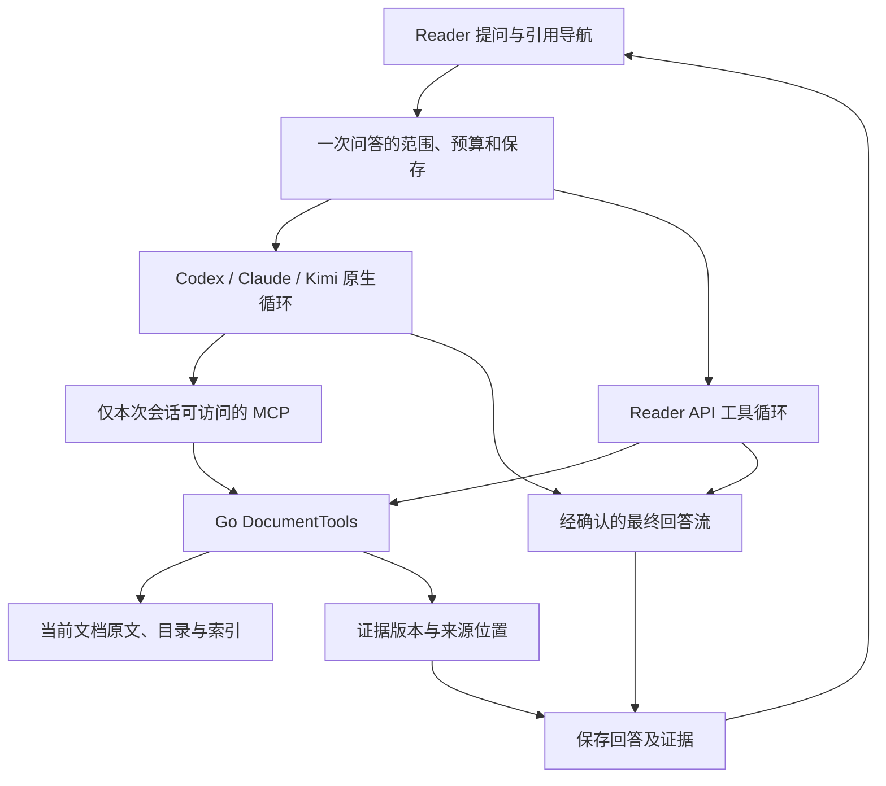

# #41：当前文档 Agent 的技术取舍与实施设计

原设计日期：2026-10-13。本文保留当时的设计及核查记录。用户随后授权实施，2026-10-14 已完成 Codex／DeepSeek API 第一阶段；实际实现、奥卡姆审查、验证和未覆盖范围见 [实施记录](../implementation/document-agent-issue-41.md)。下文的“建议”“尚未验证”描述设计时点，不能替代实施记录，也不能据此认为 Claude／Kimi、OCR 或向量检索已完成。

## 1. 决策

采用 **Reader 统一文档能力，CLI 复用原生 Agent 循环，普通 API 使用 Reader 有界工具循环**。先实现本地段落检索、目录导航和相邻原文读取，暂不引入向量数据库。工具由 Reader 实际执行；谁负责模型下一步决策，是另一个独立问题。

- Codex 继续用 Reader 启动的 `codex app-server` 子进程；Claude Code、Kimi 继续走各自原生协议。使用进程／会话范围的 Reader MCP 配置，不写用户全局配置。
- 登录约束（2026-10-13 用户确认）：复用用户已有 CLI 登录，不为文档 Agent 新建需要单独登录的配置／认证环境。Codex 采用下文的配置探测、逐项禁用和重启复核流程；登录继续由 CLI 自身管理，Reader 不读取、复制或链接凭证。
- API 首先扩展现有 Chat Completions；具备真实工具往返能力的连接进入 Agent 模式。Responses 是后续独立协议适配，不能把 `/chat/completions` 改个路径视为完成。
- 所有路径共用 Go `DocumentTools`、语料版本、权限、预算和证据记录。MCP 只是 CLI 到这些能力的协议外壳，API 在 Go 内直接调用。
- 保留原生 Agent 的检索决策能力，但不开放 shell、任意文件读取、联网、写批注或第三方工具。
- `dynamicTools` 暂不作为首版默认传输：官方仍标为实验接口。如果稳定 MCP 无法在所支持版本上实现严格隔离，应明确收窄该版本支持范围；不能以提示词声称已经限制权限。[Codex App Server](https://learn.chatgpt.com/docs/app-server)

用户所说的简单 “React 框架”在此理解为 **ReAct 式工具循环**，与前端 React 无关；实现使用结构化 function calling，不解析模型输出的 `Thought/Action` 文本，也不要求暴露思维链。

## 2. 已核查的代码基线

主目录 `/Users/jfs/Projects/reader` 核查时为干净的 `main`，提交 `a37b6bf4ead3284e1fbe2b317c4bf7b513390b37`。独立 worktree 工具实际解析到远端 main `3aa18a5976f2d39217667699ebbd500e56d95064`，随后建立 `codex/issue-41-agent-design`；下列源码结论以该 worktree 为准。两者没有在本轮合并或重置。Issue 正文基线 `84a98eb` 更早。

| 入口                                                                                                                             | 当前行为                                                                                          | 对设计的影响                                                                          |
| -------------------------------------------------------------------------------------------------------------------------------- | ------------------------------------------------------------------------------------------------- | ------------------------------------------------------------------------------------- |
| [chat_context.go](../../apps/server/internal/reader/chat_context.go)、[prompts.go](../../apps/server/internal/reader/prompts.go) | 当前摘录、附件描述、最近 8 条消息；聊天与共享系统指令均禁止工具、文件和命令                       | 需为交互式文档问答单独建立允许指定工具的策略，不能只改用户层提示词或放开共享翻译策略  |
| [api_stream.go](../../apps/server/internal/reader/api_stream.go)                                                                 | 只支持 Chat Completions SSE；消息只有 role/content；明确拒绝 tool_calls                           | 需新增结构化调用与多轮状态，不是增加一段提示词                                        |
| [connections.go](../../apps/server/internal/reader/connections.go)                                                               | 能力检测只有 Text、Vision                                                                         | 需要独立工具往返能力与协议检测，不能用“已登录／文字可用”替代                          |
| [store.go](../../apps/server/internal/reader/store.go)、[server.go](../../apps/server/internal/reader/server.go)                 | `search_index` 是 unicode61 FTS5，导入 EPUB 时按资源写入；查询先 MATCH，再补 LIKE；没有 BM25 排序 | 不具备统一 PDF／EPUB 段落检索。已有 LIKE 回退应承认并复用经验，不误称完全没有中文匹配 |
| [epub_blocks.go](../../apps/server/internal/reader/epub_blocks.go)                                                               | 按 readingOrder 提取段落，已有 href、locator、UTF-16 文本位置                                     | 可复用格式和导航映射，避免新造 PDF 式位置                                             |
| [processing.go](../../apps/server/internal/reader/processing.go)                                                                 | PDF 原文块含页码／bounds；manifest 有 parsedPages、incompletePages                                | 需要区分“已处理”与“文字完整”，不能只看完成状态                                        |
| [pdf-on-demand.md](../pdf-on-demand.md)                                                                                          | PDF 图书按章解析；关闭论文自动翻译时也不会自动启动现有版面任务                                    | **必须把供问答用的原文索引与翻译任务解耦**，否则“全文问答”仍只覆盖已翻译部分          |
| [codex_chat.go](../../apps/server/internal/reader/codex_chat.go)                                                                 | SQLite 为已提交历史权威；失败／未保存 turn 丢弃缓存                                               | 保留此约束，新增语料版本、工具策略和证据恢复                                          |
| [chat_stream.go](../../apps/server/internal/reader/chat_stream.go)、[流式约定](../agent-streaming-contract.md)                   | 增量正文、成功保存后单次 done、正文后不切备用                                                     | 工具步骤必须成为独立事件；中间模型请求完成不是一次用户问答完成                        |

以上为静态源码核查。本轮未运行 Reader 产品或真实推理。CLI 文档、版本和启动参数核查见 [CLI 适配报告](./document-agent-cli-adapters.md)；检索与参考项目见 [检索研究](./document-agent-references.md)。

## 3. 两种架构为什么选择第一种

| 维度                   | 原生 CLI 循环＋Reader API 循环（采用）                               | 全部包装成普通模型，由 Reader 统一循环                                   |
| ---------------------- | -------------------------------------------------------------------- | ------------------------------------------------------------------------ |
| Codex／Claude 原生能力 | 保留会话、上下文管理、工具调度与取消机制                             | 需约束或绕开原生循环，再由 Reader 重做                                   |
| 工具实现一致性         | 一套 DocumentTools；MCP/API 两个薄适配                               | 同样可共用 DocumentTools，不是独有优点                                   |
| 行为统一               | Reader 控制权限、证据、预算、完成语义；各 runtime 的决策轨迹允许不同 | 更容易统一轮次与消息格式，但需要更广的协议维护                           |
| 成本与延迟             | CLI 不额外套逐步 Planner；API 只做必要往返                           | 把 CLI 文本当下一步指令会增加串行往返、状态转换和失败点                  |
| 登录与产品边界         | 使用现有 CLI 的正式进程接口及其登录机制                              | CLI 协议并不自动成为公共 Responses API；不能读取凭证或调用内部后端来模拟 |
| 合适时机               | 当前 Reader 已有三种 CLI 和一个 API 接入                             | 未来若主要用户都使用直接模型 API、且确实需要完全一致的编排，再独立评估   |

“模型循环在哪里”与“工具代码在哪里执行”不应捆绑：即使循环在 Codex，搜索也由 Reader Go 服务执行，Codex 只发工具请求并接收受限结果。OpenAI 官方也将应用持有业务数据／工具、app-server 持有 Agent 循环作为产品嵌入模式；这为架构选择提供依据，但不是 Reader 集成已经验证的证据。[Codex as a platform](https://developers.openai.com/blog/codex-as-a-platform)



## 4. 检索选择：先补语料和阅读能力

RAG 是“以检索材料辅助生成”，不等于向量数据库。当前缺口首先是可查询的完整原文、可补读的上下文和可信来源映射。只加 embedding 不会补齐未解析页面，也不能解决工具循环、引用版本或回答保存。

首版采用 SQLite 段落 FTS5＋BM25、精确短语／受限字面匹配、目录与阅读顺序。英文术语保留原词；中文保留按当前文档过滤的精确子串召回，尤其是一、二字短词。中文长问句由 Agent 拆为少量关键词并根据命中继续改写；不能把整句做 LIKE 就声称具备中文问题理解。若本地扫描性能不满足固定语料预算，再在同一 SQLite 中评估 trigram 候选加速；首版不额外引入分词模型或自定义 tokenizer。不同通道先各自产生排名，再确定性融合、去重并限制同一局部片段占位；不直接相加不可比的分数。[SQLite FTS5](https://sqlite.org/fts5.html)

本轮内存数据库实验已确认：本项目 SQLite 的 unicode61 不匹配连续中文中的两字子串；trigram 也不匹配不足三字的 MATCH。带 ESCAPE 的 LIKE 不能据此获得 trigram 索引加速。该实验只验证语法／匹配边界，不是召回效果或性能评测；复现 SQL 与结果见 [检索研究](./document-agent-references.md)。

对模型暴露普通 query，不接受任意 SQL、FTS 表达式、路径或 shell。regex 不作为首版公共工具；精确术语与短语足够覆盖基础用途，正则也不能解决同义或跨语言漏召回。后续确有模式查询场景时再增加受限模式。

向量检索是后续可替换的候选召回通道：在保留测试集上，确认术语改写＋全文检索仍系统性漏掉同义、概念或跨语言证据后，比较本地 embedding＋混合检索的质量、首次索引时间、内存、磁盘与模型下载成本。即使引入 embedding，也先评估当前文档规模的本地实现，不默认部署独立向量服务。具体参考和评估口径见 [检索研究](./document-agent-references.md)。

### 4.1 全文可访问与全文读完的区别

按问题分三种工作方式，均通过相同工具，不建立复杂 Planner：

1. 定义／定位问题：检索多个表达 → 读取原段与邻段 → 引用回答。
2. 比较问题：分别取得两处原文，必要时沿目录继续补读。不能因为一个 top-k 列表只命中某一章，就替另一章下结论。
3. 全文总结／“文中是否从未出现”：先获取目录和覆盖情况，再按顺序读取。小论文可在预算内读完整篇；大文档读不完须说明实际覆盖。少量 top-k 命中不能证明读过全文，更不能证明某事全文不存在。

首版不承诺任何长度图书都能在 3 分钟内完成全书综合。若真实需求需要长时全书阅读，应另立可取消、可恢复的阅读任务；不要静默突破交互式问答预算。

### 4.2 原文索引与翻译解耦

- EPUB：从已有清洗后资源与 `readingOrder` 提取原文块，保留已有定位；目录缺失时使用 spine 资源作为可遍历单元。
- PDF（按用户纠正后的实施方式）：优先复用已有解析的原文块及坐标。仅未解析页面调用复用 [processor/text.ts](../../apps/processor/src/text.ts) 的 PDF.js 文字读取能力；没有解析缓存时才提取整个 PDF 的文字层。它不排队翻译、不启动模型生成，不改变用户暂停翻译的语义。
- 同一页只选定一个主来源，避免文字层和已有解析重复命中。带图片的表格／公式块只要已有非空原文，也纳入索引；保留已有位置和来源精度。
- 缺字／扫描页不能当空白页记为全文完整。当前 [processor/main.ts](../../apps/processor/src/main.ts) 明确尚未接入 OCR；扫描页在首版返回不可检索原因。后续接入本地 OCR 后，可作为带来源类别的新语料版本纳入同一接口，不能把这项未来能力写成现状。表格／公式的文字提取也需标质量边界。
- 页码可定位而精确 bounds 不可靠时，明确 `precision: page`，不伪造区域高亮。文本层顺序错乱也不能通过向量化修复。
- 首次旧文档访问触发有界索引准备；状态为 pending/indexing/ready/partial/failed。交互请求只在限定时间内等准备结果；超时报告未就绪，索引可独立继续，文档删除立即取消。

这比 #41 原文更明确地增加了“全文文字索引独立于翻译”这一必要基础，不改变翻译范围或默认耗费 AI 额度。

## 5. DocumentTools：三个工具与统一结果

Go 内部使用绑定范围的对象，而不是允许模型每次提供 documentId：

```go
// 设计草案；不表示当前仓库已经存在这些类型。
type DocumentTools interface {
    Outline(context.Context, OutlineQuery) (OutlineResult, error)
    Search(context.Context, SearchQuery) (SearchResult, error)
    Read(context.Context, PassageQuery) (PassageResult, error)
}
// 构造时绑定 documentID、corpusRevision、attemptID、预算和取消信号。
```

| 工具              | 参数                             | 结果及必要约束                                                                                          |
| ----------------- | -------------------------------- | ------------------------------------------------------------------------------------------------------- |
| `get_outline`     | 可选不透明 cursor                | 目录、每节首个可读 blockId、范围、覆盖状态、下一页 cursor；没有目录时给可遍历的页／spine 分组           |
| `search_document` | query、limit（默认 6，最大 12）  | 命中摘要、blockId、sectionId、来源位置、匹配类型、revision；摘要仅用于选择原文                          |
| `read_passage`    | blockId、before、after（各 0–3） | 原文及邻段、sourceId、哈希、版本、位置、prevBlockId／nextBlockId、truncated；可直接从目录入口开始顺序读 |

三个工具足以进行目录阅读；不是必须先搜索命中才能读。所有 schema 拒绝多余字段，校验参数类型与长度。超长自然段在建立检索单元时按文本 span 切分，每个单元映射回原生 block；不会截去后半段却不给继续读取入口。

通用结果封装：

```json
{
  "corpusRevision": "rev-opaque",
  "coverage": {
    "status": "partial",
    "totalUnits": 20,
    "searchableUnits": 18,
    "missingRanges": [{ "type": "pdf", "fromPage": 7, "toPage": 8 }],
    "warnings": ["第 7–8 页尚无可用文字"]
  },
  "items": [],
  "truncated": false,
  "nextCursor": null
}
```

这是建议结构，不是既有 OpenAPI。PDF 单位为页；EPUB 为 spine 资源，并另报块数与提取失败情况，不能拿两者的 totalUnits 作横向质量比较。覆盖完整也仅表示已尝试并具有可用文本，不是 OCR、表格或公式内容百分之百正确。

错误区分 `invalid_arguments`、`unknown_tool`、`source_stale`、`not_ready`、`budget_exhausted`、`document_unavailable`。可恢复参数错误可作为结构化工具结果交给模型修正，但仍计次数；未知工具绝不执行。取消、文档不可用与预算耗尽终止本次运行，不通过无限回传错误维持循环。

### 5.1 数据与索引生命周期

建议增加可重建的 `document_corpora`、`document_passages` 与专用 `document_passages_fts`，不要直接改掉供现有 EPUB 页面搜索／分类使用的 `search_index`。

- corpus 保存 revision、提取器版本、文档内容指纹、覆盖与状态；passage 保存顺序、section、原文、原生位置、哈希、来源种类和精度。
- 语料更新采用 staging revision：准备好正文和 FTS 后事务切换 active revision。不得让工具在同一响应中读到新正文配旧位置。
- 一次问答固定 revision；更新期间可完成旧快照，但来源标明版本。旧 revision 在活动请求释放前保留；新问答用新版本。旧证据点击时重新核验，不能导航到同 ID 的新内容。
- FTS 虚表清理由迁移／删除代码显式维护或使用验证过的触发器，不能依赖外键自动级联。文档删除、放入回收站、恢复、重处理均有测试。
- DB 当前只有一个连接，不能持有事务等待模型，也不能边持有 rows 边进行另一次查询；提取在事务外完成，短事务提交索引。
- 原始 PDF／EPUB、批注和聊天不因索引重建而删除。索引损坏可重建；证据快照属于聊天事实，不随索引重建丢失。

## 6. CLI 与 API 接入

### 6.1 CLI：进程配置，应用执行

Reader Go 服务提供经过认证、仅监听 loopback 的 MCP 端点，使用官方 Go MCP SDK 并锁定协议／SDK 版本；不手写完整 MCP 协议。首版选择 Streamable HTTP，避免再加一个持有 SQLite 的常驻进程；校验 Host 和 Origin，拒绝非允许来源，不能把 localhost 当作免认证依据。Kimi 所支持版本若只能使用 stdio，可增加仅转发的子命令，仍只调用同一个 Go 服务，不能再实现一套检索。[MCP transports](https://modelcontextprotocol.io/specification/2025-11-25/basic/transports)

认证使用独立随机能力令牌，绑定一个 document／runtime 会话及当前 active attempt。它不是 Reader 主 API token，不能用于其他路由。每次用户 turn 激活新的预算记录；不存在 active attempt 时拒绝读取。失败、取消、超时、删除或 runtime 销毁均撤销授权；跨 Provider 回退重新发令牌。令牌不进入工具参数、提示词、来源 URL 或日志，原生缓存按文档和策略隔离。

Codex 通过 app-server 的进程覆盖或 thread 配置注入；Claude 通过 `--mcp-config`／`--strict-mcp-config` 注入。具体可用参数及冲突见 [CLI 报告](./document-agent-cli-adapters.md)。必须先在空临时工作目录做工具清单和权限探测，再允许 Agent 模式。不得执行 `codex mcp add`、`claude mcp add` 来修改用户配置；不得读取或复制其凭证。

版本事实必须进入实施计划：本机 Codex 为 `0.162.0-alpha.17.2`、Claude 为 `2.1.191`；本机无 Kimi。Codex 上游配置合并对 table 递归叠加，空 `mcp_servers` 不清空继承项；Claude 的 safe-mode 禁用 MCP，直接去掉又会改变自定义内容隔离；所查 Kimi 上游 ACP 启动路径没有应用 Reader 传入的 agent profile。这些是具体协议／源码风险，不等于已经在用户运行环境复现越权。应优先验证 Codex＋一个 API，Claude／Kimi 按版本独立启用。

Codex 首个接入实验采用明确顺序：启动即关闭 plugins/hooks/apps 的探测进程 → initialize → 只读 `config/read`，不创建 thread、不调用 MCP 状态发现 → 只保留继承 MCP 的名字并退出 → 对每个名字显式设置 `enabled=false`，连同 Reader MCP 配置启动正式进程 → 再复核配置 → 创建 thread。所查源码支持探测读取配置不会自行连接 MCP，但这**尚未经过本机启动副作用验证**；`config/read` 会返回完整有效配置，Reader 必须丢弃不需要的字段、禁止记录或持久化秘密值。

枚举方案还需解决复核后配置变化、thread 启动重新加载的竞态，不能宣称仅凭两次检查已获得严格隔离。实施须在复用既有登录的前提下验证这些边界；若某个版本／环境无法满足，暂不开放其原生文档 Agent，并说明具体不兼容原因。独立配置／认证环境及额外登录不作为备选，不通过复制或链接凭证绕过这一约束。

验收工具限制不能只检查 Reader MCP 的 tools/list：还需确认 runtime 的内置工具、继承 MCP、插件、hooks、skills、子 Agent 与网络能力不扩大范围。`sandbox=read-only` 仅限制写入，不等于没有任意文件读取。无法证明这些边界的 runtime 版本保留现有受限聊天／预检索模式，显示能力限制，不静默开放权限。

### 6.2 API：结构化、有界的循环

在现有 adapter 旁增加交互 Chat 专用工具路径，翻译／图片原路径不自动进入工具循环。保留原连接类型及配置快照。

1. 组装已提交历史、当前问题、覆盖摘要及三项工具 schema。
2. 发送一次流式模型请求，聚合每个调用的 ID、名称和分片参数。完整参数和本轮成功终态到齐后才可执行，绝不执行半截 JSON。
3. 严格校验 schema、权限、revision、剩余预算。首版按调用顺序串行执行，支持一轮多个调用及每个调用对应一个结果。
4. 将本轮完整 assistant tool_calls 与匹配的 role=tool/tool_call_id 消息一起回传，保留原调用 ID。继续由模型决定搜索、补读或停止。
5. 无工具调用的成功 stop 表示阅读阶段结束；进入最终回答阶段。整个循环成功后才允许保存一次助手结果。

Chat Completions 需处理 `delta.tool_calls[index]`、`finish_reason=tool_calls`、`stop` 与 `[DONE]`；Responses 则是 output item、call_id、参数完成和 response 完成事件，并需要保留其要求的续接信息。这两类状态不能用一个“有字符串就是回答”的 decoder 混写。模型返回的 opaque continuation／reasoning items 按官方协议回传，不渲染或当作文档证据。[OpenAI function calling](https://developers.openai.com/api/docs/guides/function-calling)

工具能力检测使用 Reader 自己的无敏感内容测试工具：模型产生合法调用 → 返回随机短 nonce → 模型根据结果完成回答，同时验证流式参数与 ID 匹配。检测键至少包含连接地址／协议、凭证指纹、模型、工具 schema 版本；不保存明文密钥。状态为 unknown/passed/unsupported/failed，网络暂时失败不等于不支持。设置中的现有“检查”流程可承担该探测，避免每条问题先加一次无关请求。

不支持工具的模型使用应用预检索＋补取邻段后生成，标为“检索辅助回答”。能力 unknown 不伪装成 Agent；切换模型／连接后重新检测。不因工具能力不足删除原有文字聊天能力。

## 7. 正文流、工具活动与保存

### 7.1 必须先解决中间文字歧义

工具循环内，模型可能先说“我先检查方法章节”，再调用工具。不能把这些文字直接拼入最终回答，也不能把一次工具轮结束当 done。

**采用兼容性优先的基线：阅读阶段与最终成文阶段分开。** 阅读阶段保留原生／API 自主循环，工具输出形成 Reader 证据账本；该阶段的模型文字不发送正文 delta。阅读完成后，以用户问题、已提交历史和有界原文证据发起一次禁用所有工具的成文请求，沿用现有增量输出路径。成文时不得新增未经读取的来源；空证据明确回答不足。

这会增加一次成文调用及相应延迟／用量，需在实测报告单独记录。它不引入第二个搜索 Planner，也不把 CLI 每次工具决策都外包给 Reader。它解决了 Chat Completions／Claude 等协议无法在首个文字片段到达时确定该消息是否随后发出工具调用的问题。

对不支持同线程可靠关闭工具的 runtime，成文使用隔离的无工具调用／会话，从 SQLite 已提交记录和 Reader 证据重建上下文，不依赖前一会话的隐藏状态。不要声称只改一下 thread 配置就一定生效。原生缓存需要分离阅读会话与最终问答缓存，或首版只复用已有无工具成文缓存；任何阶段失败都不得复用含未提交 turn 的会话。

可选优化：仅在某个版本证明 final-answer phase 在首 delta 前可靠可用、且整个 turn 完成语义符合约定后，让该 adapter 直接流式输出最终消息，省去二次成文。不能仅凭 Codex 存在 `phase` 字段就默认成立；模型／runtime／协议均需验证。

### 7.2 SSE、证据与事务

- 现有 `status/delta/fallback/error/done` 语义保持。建议增加独立 `activity {phase, tool?, step?, message}` 事件，phase 为 searching/reading/writing，内容由 Reader 生成，工具参数、原文结果、推理和日志不外泄到正文。
- 这是**待实施的协议变更提案**。同一提交更新流式约定、OpenAPI、生成类型、SDK decoder、前端消费与 fixtures；本文不修改冻结协议或宣称新字段已可用。
- `read_passage` 生成本次 attempt 的 sourceId。模型使用如 `[S1]` 的标识；后端以实际读取证据解析引用，不接受模型自造的页码、URL 或 locator。来自用户选区的既有引用保留其不同来源类型。
- 保存引用过的证据快照：原文、sourceId、原生位置、revision、contentHash、提取来源和精度；另存有限的工具执行记录。检索候选摘要本身不直接变成已核验的最终引用。
- sourceId／版本／快照存在性校验不等于回答语义正确。不伪造来源补全未知 ID；未知 ID 不渲染成可点击证据，保留显式未核验状态。发布评估要求不存在伪造的“有效引用”。
- 最终消息、引用映射和成功 run 状态在同一事务提交；只有随后发送一次 done。用户问题沿用现状先保存，失败后保留问题但不保存不完整助手答案为成功。
- 工具轨迹／失败 attempt 与 messages 分开；必要证据随成功历史恢复，不能只恢复回答而丢掉下一轮需要的原文。无需原样恢复旧 runtime 的 call_id，跨 runtime 始终重建独立尝试。
- 读取阶段可以在无正文前按既有规则切已配置备用；旧运行的授权与调用 ID 失效。成文 delta 出现后禁止切换；取消和总超时均不自动回退。
- 每次模型调用分别记用量；原生只有会话累计用量时计算差值，不把阅读与成文的累计量重复求和。缺失用量记 unknown，不能算零。

前端复用现有 ReaderAdapter 导航：PDF 跳页／bounds，EPUB 使用 href／locator／span；过期来源保留历史快照并提示位置待重新确认。界面只需简短读取状态和可点击来源，不增加 Agent 控制台或装饰文案。

## 8. 预算与失效处理

以下是待测的首版默认值，不能作为已实现限制或质量保证：

| 限制           | 建议值／行为                                                                                 |
| -------------- | -------------------------------------------------------------------------------------------- |
| 用户请求总时长 | 保留 3 分钟，涵盖阅读、成文、保存；不逐轮重置                                                |
| 工具次数       | 16 次／用户请求；无效调用也计数，备用沿用总剩余额度                                          |
| API 模型轮次   | 阅读最多 8 轮＋成文 1 轮；CLI 无法可靠统计内部轮次时依靠工具次数和总时长，不虚报等价轮次上限 |
| 单工具结果     | 最多 12 KiB UTF-8；按结构截断并返回后续入口                                                  |
| 去重证据总量   | 默认 48 KiB；连同用户摘录、历史、工具 schema 和输出预留一起检查模型上下文上限                |
| 输入参数       | query 最多 512 UTF-8 字节；工具参数总量最多 4 KiB／次                                        |
| 最终回答       | 沿用 1 MiB；输出长度限制依模型另设，不能把字节数当 token 数                                  |

这些预算针对当前文档的交互问答。正文截断和证据截断必须明确区分；文档大时返回“本次读取范围不足”，不把正常预算停止伪装为全文成功。达到硬次数／时间上限时终止 run，不额外生成一份被标成完整成功的答案。模型在限额前自愿结束、并清楚说明证据不足的完整回答可正常保存。

MCP 请求本身的 HTTP context 不代表用户聊天仍有效；工具执行同时检查 active attempt、文档存活、固定 revision 和父 context。取消／删除与正在执行的 SQLite 查询、子进程和证据写入都必须关联。

## 9. 可独立评审的实施顺序

| 阶段／建议提交          | 交付内容                                                                                   | 阶段门槛                                                   |
| ----------------------- | ------------------------------------------------------------------------------------------ | ---------------------------------------------------------- |
| 0. 接入验证             | 在临时原创材料上验证 Codex 的 MCP 隔离、三工具调用；API 完成调用与回传；确认阅读／成文拆分 | 先解决版本和权限可行性，不在不安全假设上铺业务代码         |
| 1. corpus               | EPUB 原文与 PDF 全页文字提取、覆盖、版本、索引迁移与清理                                   | 重处理／删除／重启不丢用户数据；关闭翻译仍可建立原文索引   |
| 2. tools                | 三工具、FTS／中文策略、相邻读取、证据预算；预检索复用                                      | 确定性 fixture 在真正工具边界返回预期原文；不能称 #41 完成 |
| 3. first-agent-paths    | Codex MCP＋Chat Completions 工具循环及能力检测，阅读／成文生命周期                         | 两类路径真实完成搜索→补读→回答，失败和取消不污染会话       |
| 4. citations-and-ui     | run／evidence 持久化、引用导航、activity 事件与所有 schema／消费者                         | 一次问题只存一次完整答案；精确位置和过期引用可人工核验     |
| 5. other-clis           | Claude Code、Kimi 同一 MCP 接入，逐版本隔离和真实调用                                      | 未验证版本明确降级，不宣称三种 CLI 全部已可用              |
| 6. retrieval-evaluation | 固定问题集、召回和证据支持率、成本／延迟报告                                               | 按漏召回类型判断要不要追加向量通道                         |

紧耦合的 schema、类型、实现和测试同提交；不能把一个阶段拆成可运行性损坏的中间提交。阶段 3/4 的必要 UI／协议若相互依赖，可作为一个可验证的纵向切片合并提交。Responses、跨文档、自动写批注、通用多 Agent 不进入本次范围。

建议文件职责：`document_corpus.go` 管语料快照与生命周期，`document_search.go` 管候选召回，`document_tools.go` 管三工具与授权预算，`document_mcp.go` 只做 MCP 适配，`api_chat_tools.go` 管 API 消息和循环，`chat_evidence.go` 管来源与事务。现有 `generation.go` 保留 Provider 选择／备用／用量边界，`chat_stream.go` 保留用户请求完成边界；不在各 adapter 内重复实现业务检索。这些名称是实施落点建议，可按实际接口调整。

## 10. 验收与证据记录

先建立原创 PDF／EPUB 对照材料与 gold passage/span；覆盖定义在另一页、两个章节比较、引用紧邻补充条件、同名概念、中文查询英文正文、无答案、长段、目录缺失、扫描／缺字页、只处理部分书籍和文档注入指令。

分四层记录，不能互相替代：

1. **检索／工具测试**：gold passage recall@k、必需的多处证据覆盖率、顺序读取可达性、跨文档拒绝、FTS 转义、预算、版本失效；去重不得误删不同位置的同文段。
2. **协议与生命周期测试**：分片参数、多工具、重复／缺失调用 ID、未知工具、非法 JSON、缺少终态、错误后迟到事件、超时／取消、文档删除、保存失败、备用独立 attempt、断流后消息核对、逐次用量。
3. **真实 CLI／API 验证**：记录精确 runtime 版本、模型 ID、协议、语料版本、问题、工具参数与返回原文、阅读与成文调用、完成／保存状态、延迟、用量和失败。至少实际观察“搜索→读取→补充搜索／读取→最终回答”；答案碰巧正确不算多步验证。
4. **人工体验与质量**：提供可访问 Reader 开发预览，检查 PDF／EPUB 引用、取消、未准备原文、仅检索模式、首段提前到达、无重复正文、明暗主题。不用浏览器自动化验收视觉。

实施后按仓库运行 `pnpm typecheck`、`pnpm test`、`pnpm build`。本轮只有研究文档，执行文档内容／链接和 diff 检查，不运行应用构建；不以历史测试结果为本功能背书。

尚待实施阶段确认的事项：Codex 指定版本能否在保留用户既有正式登录的同时屏蔽全部继承工具；Claude 去掉 safe-mode 后的 hooks／插件／设置隔离；Kimi 本机运行环境；所选 API 模型真实工具能力；PDF 全页文字提取质量与中文召回。它们影响支持矩阵或具体参数，不改变本文共享 DocumentTools 与复用原生循环的总体取舍。
